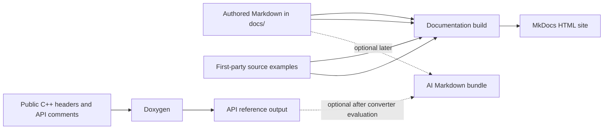

# GraphicEngine Documentation Pipeline Plan

## Assessment

The proposed dual-target approach is feasible, with some changes for this repository. The project has manual documentation under `docs/` and public headers across `GraphicEngineCore`, `GraphicEngineEditor`, and `GraphicEngineBackends/D3D11`. It does not currently have Doxygen-style comments in its first-party C++ headers and sources, so generating a complete API reference immediately would produce little useful contract documentation.

The original plan also relies on Doxybook2, whose repository was archived in 2022. Treat Doxygen XML-to-Markdown conversion as an optional tool choice to validate, not as a fixed pipeline dependency. Doxygen's native HTML output is the lower-risk initial API reference format. See the [Doxybook2 repository](https://github.com/matusnovak/doxybook2) and [Doxygen output formats](https://www.doxygen.nl/manual/output.html).

The examples in the original proposal need to match this engine: it is Windows-first and currently uses a D3D11 backend, not Vulkan. The current `.gitignore` also ignores `*.md`; the plan file is explicitly allowed there, and any new docs pages need a deliberate tracking rule.

## Goals and source ownership

Keep documentation sources in Git and treat generated output as disposable build artifacts.

- `docs/` contains authored guides: onboarding, build and validation workflows, architecture, rendering, assets, logging, and troubleshooting.
- Public C++ header comments describe API contracts, parameters, ownership, threading, errors, and focused examples.
- Code examples come from first-party source or tests so they stay aligned with implementation.
- The website and any future AI bundle are generated from those sources; they are not edited by hand.

MkDocs builds the human-facing site. Doxygen extracts API documentation from C++ comments. An AI-ready Markdown bundle is deferred until a concrete consumer requires one. MkDocs supports an explicit docs directory, navigation, and strict builds that fail on warnings; see the [MkDocs configuration guide](https://www.mkdocs.org/user-guide/configuration/).

## Phase 0: Establish scope and ownership

1. Make the first deliverable a versioned documentation site, not an MCP server.
2. Inventory public headers under:
   - `GraphicEngineCore/modules/*/include`
   - `GraphicEngineEditor/modules/*/include`
   - `GraphicEngineBackends/D3D11/include`
3. Keep `vendor/`, `out/`, generated output, tests, and private implementation trees out of the public API reference unless a specific maintainer need justifies including them.
4. Define the content split between API contracts in source comments, conceptual and workflow guides in Markdown, and implementation examples in first-party code.
5. Preserve existing local `.gitignore` edits while allowing the intended documentation pages and README to be tracked. Ignore generated site and API output directories.
6. Review current pages for stale paths and claims. For example, `docs/validation/windows.md` refers to `scripts/verify-windows.ps1`, which is absent from the current working tree.

## Phase 1: Build the manual documentation site

1. Add `mkdocs.yml` with `docs_dir: docs`, explicit navigation, search, and strict mode for CI and release builds. Use MkDocs Material if its theme features are desired.
2. Doxygen and Python are already installed on the developer machine. Create a project-local Python virtual environment (for example `.venv-docs/`) and install the remaining documentation packages there, including MkDocs, the selected theme, and Markdown extensions. Record and pin those packages in a dependency file such as `requirements-docs.txt`; do not install them globally or mix them into the C++/vcpkg dependencies.
3. Add `docs/index.md` describing the engine and linking the existing testing, logging, rendering, and Windows validation pages.
4. Move non-Markdown support files currently under `docs/` (including `LOGGING_CMAKE_SNIPPET.cmake`) into the repository's `scripts/` directory and update any links or snippet references. Keep `docs/` focused on Markdown pages and their required media assets.
5. Document local setup, preview, and strict build commands. The docs build should not require configuring or compiling the C++ engine.

## Phase 2: Add reliable source examples

1. Use `pymdownx.snippets` for examples instead of copying implementation into Markdown.
2. Include bounded excerpts from first-party files. Avoid including full tests or implementation files when a smaller example communicates the point.
3. Use snippet markers or line ranges to keep the example stable when surrounding code changes.
4. Resolve paths from a documented repository-relative root and restrict them to approved first-party directories.
5. Fail the docs build when an include is missing or invalid. Do not silently substitute an error comment into published documentation.
6. Keep include directives in the Markdown content so the extension inserts source inside the intended language fence.

## Phase 3: Pilot API documentation

1. Add a Doxygen configuration that reads public header roots and relevant project documentation, excludes `vendor/`, `out/`, tests, and private source trees, and generates XML. Generate native HTML for the pilot if it is the chosen publication format.
2. Start with `EXTRACT_ALL = NO` and do not expose private members by default. Doxygen documents that `EXTRACT_ALL = YES` disables warnings about undocumented members, which would conceal the current coverage gap. See [Doxygen configuration](https://www.doxygen.nl/manual/config.html).
3. Use the `GraphicEngineCore` subproject as the representative pilot slice. Add API comments to selected public headers in its `runtime`, `assets`, `scene`, and `rendering` modules, covering result/error conventions, asset APIs, scene APIs, and rendering interfaces. Keep Editor and backend APIs out of this first coverage milestone.
4. Inspect the pilot for templates, overloads, namespaces, cross-references, and C++23 declarations.
5. Choose the final format after the pilot:
   - **Lower-risk initial option:** publish Doxygen HTML alongside the MkDocs site and link to it.
   - **If Markdown API pages are required:** evaluate a maintained XML-to-Markdown converter or build a narrowly scoped converter from Doxygen XML. Verify member links and generated page quality before adoption.
6. Begin with Doxygen warnings visible. Tighten them as API comment coverage improves; enabling `WARN_AS_ERROR` for the entire undocumented codebase at the start would make adoption unnecessarily difficult.

## Phase 4: Repeatable build and CI

1. Add a Windows-first script such as `scripts/build-docs.ps1`. It should check required executables, activate or invoke the project docs virtual environment, report each step, propagate command failures, and write only to known generated directories.
2. Keep documentation dependencies independent of CMake configuration and compilation. The engine's Windows, Visual Studio, Ninja, and vcpkg workflow should not be required to build the docs.
3. Add GitHub Actions CI/CD configuration under `.github/workflows/` that installs Doxygen, sets up Python, creates the docs virtual environment, installs the pinned documentation dependencies, and runs the strict docs build on pull requests and documentation changes. Keep deployment as a separate workflow/job or later decision once hosting is selected.
4. If an XML-to-Markdown converter is selected, pin its version and add a small fixture or output check to catch conversion regressions.
5. Decide site hosting and publication separately; local docs and CI validation do not depend on that decision.

## Phase 5: Optional AI/MCP output

Add an AI bundle only when a real client or workflow needs a portable Markdown corpus. Generate it from the same sources into an ignored path such as `out/docs/ai/`.

The generator should:

- preserve the manual docs hierarchy and relative links where possible
- expand the same snippet syntax used by MkDocs
- include only selected API pages or summaries
- fail on missing includes and unresolved references
- reject paths outside approved project roots
- record source file paths for included code
- exclude secrets, build artifacts, and vendored code

A general filesystem MCP server exposes file operations, not just documentation reading; the official server lists reading, writing, directory creation and deletion, moving, and searching as features. Restrict allowed roots and use read-only access where supported. See the [MCP filesystem server](https://github.com/modelcontextprotocol/servers/blob/main/src/filesystem/README.md). A curated read-only documentation server or a client's existing repository access may be a better fit if richer discovery is needed.

## Recommended delivery order

1. Allow intended Markdown files through `.gitignore`, move documentation support snippets from `docs/` to `scripts/`, and add the MkDocs manual site.
2. Create the docs virtual environment, install the pinned MkDocs/theme/extension packages into it, and document local setup.
3. Validate source snippets and correct stale documentation references.
4. Pilot Doxygen on selected public APIs in `GraphicEngineCore`.
5. Add GitHub Actions CI/CD validation using installed Doxygen and Python plus the project docs virtual environment.
6. Select a maintained API Markdown converter only if Markdown API output is a real requirement; then decide whether an AI bundle or MCP integration has a concrete consumer.

This order delivers useful documentation early and avoids making the system depend on an archived converter or a second content tree before either is needed.
