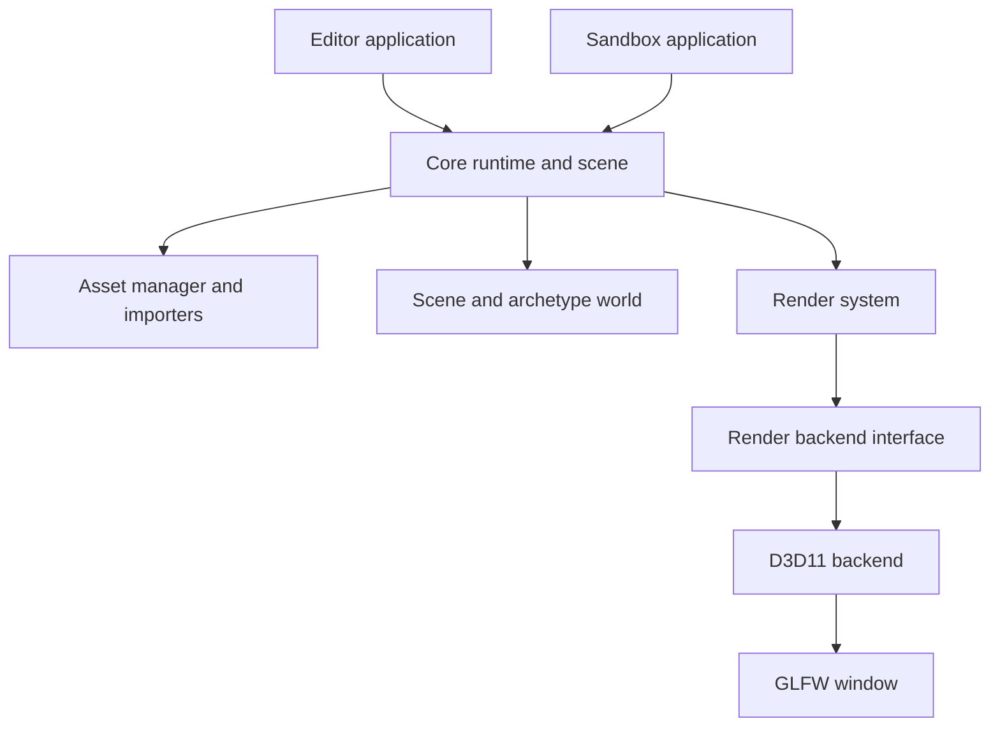
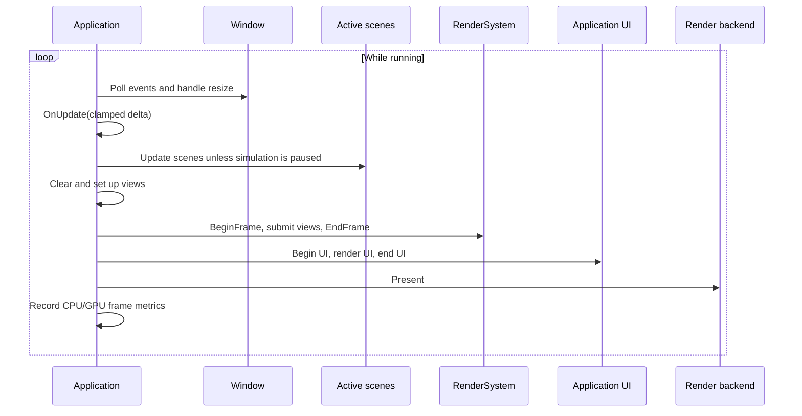

# Architecture

GraphicEngine is a Windows-first C++23 engine organized as a set of CMake
subprojects. Core owns runtime services, assets, scenes, and renderer
coordination. The D3D11 backend implements the rendering and window-facing
interfaces; the Editor and Sandbox applications assemble these pieces.

## Subsystems and ownership

`Application` is the runtime composition root. It takes exclusive ownership of
the window and rendering backend, creates the `RenderSystem`, and owns the
asset manager. It keeps active scenes through `shared_ptr` references. The
renderer uses backend-owned device and command-list objects; it does not own the
backend. GPU resources are held by renderer resource managers and released
before the backend is destroyed.

The high-level dependency direction is:

The diagram shows conceptual dependencies, not a strict one-way layering
boundary in every legacy header. The C++ guidelines describe the intended module
layout and dependency rules.

## Core paradigms

### Explicit lifetime ownership

Use RAII and keep the owner visible. `Application::Run` receives its window and
backend as `unique_ptr`s and moves them into application ownership. A scene may
be shared by the application and editor systems with `shared_ptr`; a scene owns
its archetype world and scheduler. `RenderSystem` retains a non-owning backend
pointer, so its lifetime must remain inside the backend's lifetime. The
application destructor waits for device work, then releases renderer resources
before destroying the backend and window.

Public APIs use `Result<T>` or `Status` for recoverable failures. Do not treat
null resource handles or exceptions as the normal error path; check and report
the returned diagnostic at the call site.

### Scenes, entities, and systems

Each `Scene` owns an `ArchetypeWorld`. Entities are identified by a slot and a
generation counter, so a stale handle does not become valid when a slot is
reused. Components of matching type signatures are stored together in fixed
capacity chunks, and systems query matching component columns in batches. This
keeps iteration contiguous and avoids one heap allocation per component.

Structural edits are restricted during component queries and system execution.
Scene commands are queued and applied at synchronization points. The
`SystemScheduler` uses declared read/write component sets to form deterministic
batches and runs structural writers alone with a synchronization barrier.
Execution is currently single-threaded: batches describe access conflicts; they
do not create worker threads.

## Runtime and editor frame loops

The base application loop polls window events, clamps the update delta to 100 ms,
updates application and active scene state, prepares view bindings, submits
rendering work, draws UI, presents, and records frame diagnostics. An editor
application provides its own update, view setup, and UI callbacks. A regular
application may use the default view, which selects an active visible scene
camera when one is available.

The update delta cap prevents a long pause from producing an unbounded scene
step. Rendering and presentation still proceed while simulation is paused.
Details of render graph passes and resource flow are in the rendering guide.

## Architecture decisions and current limits

- **Backend interface around D3D11:** Core talks to `IRenderBackend`; the
  current application executables construct the D3D11 implementation. The
  abstraction separates renderer coordination from device and swap-chain
  ownership, but this repository currently ships a D3D11 backend.
- **Archetype ECS:** Component columns support contiguous iteration and
  signature-based queries. Structural changes require explicit synchronization
  so query spans and entity locations remain valid.
- **Deterministic scheduling:** Access declarations identify conflicts and
  structural barriers. System batches currently execute serially; parallel
  execution is not implemented.
- **CMake modules:** Core, D3D11, Editor, and Sandbox have separate targets and
  public include areas. These are project modules, not C++ language modules.
- **Documentation/API generation:** Doxygen reads first-party public headers
  and MkDoxy generates searchable API pages inside this MkDocs site. The
  current coverage is being expanded to Editor and D3D11 as well as Core.

See [C++ guidelines](cpp-guidelines.md), [testing and performance](testing.md),
and [the API reference](api-reference.md) for the corresponding developer
contracts.
