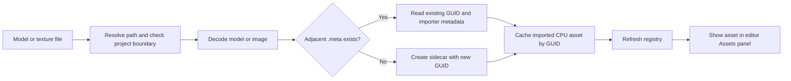

# Asset pipeline

GraphicEngine imports model and image files into CPU-side asset records. The
project root is the boundary for asset sources and any external resources
referenced by a model. Imported assets are identified by GUIDs stored in
adjacent `.meta` sidecars, so scenes and material assignments can refer to
assets without depending on their display names.

## Supported source formats

| Asset | Accepted file extensions | Imported representation |
| --- | --- | --- |
| Model | `.gltf`, `.glb` | glTF 2.0 scenes, nodes and transforms, meshes and primitives, supported material values, samplers, and decoded images. |
| Standalone texture | `.png`, `.jpg`, `.jpeg` | Decoded RGBA8 pixels. |

Extensions are matched without regard to case. A model may use embedded data,
resources in a GLB container, or external buffer and image URIs. External URIs
must resolve to files inside the project root. For images referenced by glTF,
the declared MIME type must be PNG or JPEG; when no MIME type is declared, the
image URI must end in `.png`, `.jpg`, or `.jpeg`.

The standalone image dialog offers PNG and JPEG. The model dialog offers glTF
and GLB. Formats such as OBJ, FBX, TIFF, BMP, and DDS are not supported by the
current asset import APIs.

## Import workflow

In the editor's **Assets** panel, choose **Import model...** or **Import
texture...**, select a file under the project directory, and let the editor
refresh its asset registry. The file picker starts at the project root. The
same operations are available to code through `AssetManager::ImportModel` and
`AssetManager::ImportTexture`.

The pipeline follows these steps:

1. Resolve the source path and reject missing files or paths outside the
   project root.
2. Decode the selected model or image. For glTF, resolve external buffer and
   image URIs and verify that they remain inside the project root.
3. Read the adjacent `<source-file>.meta` sidecar, or create one with a new
   GUID after a successful import. The sidecar records the asset type,
   importer identity and version, schema version, and GUID.
4. Store the imported CPU data in the asset manager cache under that GUID.
5. Refresh the registry to discover sidecars and publish the known models and
   textures to the editor's Assets panel.

During project startup or an explicit registry refresh, the asset manager
scans `.meta` files recursively and loads valid referenced assets. Malformed
or unsupported metadata and assets that cannot be loaded are reported as
warnings; duplicate GUIDs are also reported. Keep sidecars beside their source
files when moving or backing up project assets.

## Model data and material support

The importer preserves the glTF scene graph, scene roots, local node
transforms, mesh primitives, and material assignments. It reads positions,
optional normals and tangents, vertex colors, and up to eight texture
coordinate sets (`TEXCOORD_0` through `TEXCOORD_7`). Missing normals and
tangents are generated for triangle primitives. Triangle strips and fans are
expanded to triangle lists; line loops are expanded to line segments.

Imported glTF material data includes metallic-roughness factors and textures,
base color, emissive values, normal and occlusion textures, alpha mode,
double-sided state, sampler settings, and the supported
`KHR_materials_pbrSpecularGlossiness` and `KHR_texture_transform` extensions.
Textures are decoded to four-channel, 8-bit RGBA pixels for the CPU asset
representation.

GPU mip chains cover the complete source footprint for odd and non-square
images. Normal-map mips average tangent-space vectors and renormalize each
result. Masked base-color textures use alpha-coverage adjustment at the
standard 0.5 cutoff; other texture uses keep their filtered alpha values.

## Limitations and troubleshooting

- Skinning and animation are not imported. Models with skins produce a warning
  and use bind-pose geometry; animation data is ignored with a warning.
- Required glTF extensions other than
  `KHR_materials_pbrSpecularGlossiness` and `KHR_texture_transform` fail
  import. Unsupported optional extensions are ignored with a warning.
- Sparse accessors, skinning vertex attributes (`JOINTS_*` and `WEIGHTS_*`),
  and texture coordinate sets above `TEXCOORD_7` are unsupported.
- glTF images must decode as 8-bit unsigned pixel data and be PNG or JPEG.
  Unsupported image formats, malformed geometry or transforms, invalid
  sampler values, and out-of-project external URIs fail import.
- Imported data is held in the asset manager's CPU cache. The asset manager
  does not create renderer GPU resources as part of file decoding.
- The Assets panel currently emits a request from **Reimport selected**, but
  the editor has no handler for that request yet. Reimport through the asset
  manager API or reopen the project to reload files; the panel button does not
  currently perform a reimport.
- Reimporting an existing source preserves its sidecar GUID and advances its
  in-memory generation. If a `.meta` file is copied with another asset, its
  GUID becomes a duplicate and the registry reports the conflict; do not copy
  sidecars when making a distinct asset.

For a failed import, inspect the returned error or the editor log for the
source path and failure reason. Confirm that the extension is supported, the
file is readable, all external glTF resources are within the project, and
each sidecar belongs to only one source asset.
