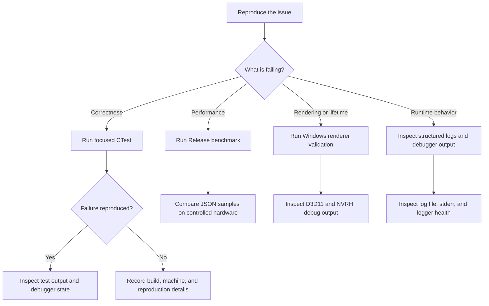

# Profiling, debugging, and QA

Use this guide to choose a diagnostic path and find its output. The detailed
commands and platform-specific setup remain in the linked workflow pages.

## Choose a workflow

## Performance measurement

The repository's checked-in microbenchmark target is optional. The documented
`GraphicEngineBenchmarks` target currently measures ECS archetype column
iteration; it does not cover transforms, scene loading, assets, or the render
graph. The configure/build command, benchmark arguments, and JSON output path
are in [Testing and performance](testing.md#benchmarks). Keep benchmark output
with the build tree or choose a separate output path. Compare Release results
from controlled hardware and record the commit, compiler, OS, CPU, benchmark
version, power mode, and background load. Timing is not a CTest gate.

For CPU source coverage, the separate clang-cl/LLVM workflow in
[Testing and performance](testing.md#source-coverage) produces raw
`out/coverage/run-*.profraw` files, a merged `merged.profdata`, a text report,
and `core-coverage.json`. Its filters count Core production C++ only. Coverage
does not measure GPU-only behavior or Windows driver execution. The normal
MSVC preset does not enable this instrumentation.

There is no checked-in engine-wide profiler integration or performance
baseline suite documented today. For a hot path outside the benchmark target,
capture a sampling profile with Visual Studio Performance Profiler's CPU Usage
tool when installed, or with Windows Performance Recorder when the Windows ADK
is installed. Save the capture with build and machine details, and treat it as
an external investigation artifact rather than a repository-generated report.
Use Release configuration for timing-sensitive captures; use Debug when you
need symbols and easier source inspection.

## Debugging and logging

Start from the `x64-debug` preset described in [Testing and
performance](testing.md#windows-x64-debug-environment). Configure and build the
relevant target, then launch `Editor.exe` from that build tree under Visual
Studio when source-level breakpoints or call stacks are needed. CTest failures
include the failing test name and output when run with `--output-on-failure`;
GoogleTest cases can also be narrowed with `--gtest_filter` as shown in the
testing guide.

The [Logging guide](logging.md) documents the JSONL file path and
`ENGINE_LOG_PATH`, `ENGINE_LOG_LEVEL`, and logger initialization options. On a
file-sink initialization failure, logging remains available in memory and the
failure is written to platform debug output and stderr. Check the return value
from `Engine::Log::Initialize` and inspect `Engine::Log::GetHealthSnapshot()`
for sink state, queue drops, callback failures, and file failures. Preserve the
relevant log excerpt and health snapshot with a bug report; redact sensitive
paths or values before sharing logs outside the team.

For rendering errors, Debug builds enable the D3D11 debug device and NVRHI
validation layer when available. The manual checks and expected error-clear
behavior are listed in [Windows build and renderer
validation](validation/windows.md). Inspect Visual Studio's Debug output and
the D3D11/NVRHI diagnostic output when investigating resource lifetime, API
state, resize, or shutdown problems.

## QA and validation paths

Use the least expensive check that gives evidence about the change, then run
the broader documented gate before review when the toolchain permits:

1. Run the focused CTest selection for the affected behavior.
2. Run the unit and integration labels, or the full CTest suite, using the
   commands in [Testing and performance](testing.md#running-focused-and-full-checks).
3. Run the documented Windows configure/build/test script from
   [Windows build and renderer validation](validation/windows.md). Its result
   covers build and registered tests on that machine.
4. For D3D11, NVRHI, resource lifetime, or viewport changes, complete the
   manual editor scenarios in the Windows validation guide. CTest does not
   create a graphics device, so passing CTest alone is not evidence that those
   GPU paths were exercised.
5. Run the source Markdown lint and strict documentation build described in
   [Development workflow](development-workflow.md#documentation-and-verification-references)
   when changing docs.

Attach the command, configuration, test selection, and observed result to the
PR or issue. A successful build does not imply CTest passed; a passing CPU suite
does not validate GPU behavior. Report unavailable toolchains and skipped
manual checks explicitly.

## Common symptoms and evidence

| Symptom | First diagnostic | Evidence to retain |
| --- | --- | --- |
| A test fails locally | Re-run the named test with `--output-on-failure`; narrow GoogleTest with `--gtest_filter` | Test name, complete failure output, build configuration, commit |
| A logger file is missing | Check `ENGINE_LOG_PATH`, `Initialize` result, stderr/debug output, and logger health snapshot | Effective path, sink state, failure counters, relevant JSONL excerpt |
| Rendering shows stale or invalid resources | Run the Windows renderer scenarios with Debug device and NVRHI validation enabled | D3D11/NVRHI messages, repro steps, resize/frame sequence, commit |
| A performance result changes between runs | Repeat the Release benchmark and compare only controlled runs | Benchmark JSON, command, machine/compiler details, power mode, background load |
| Build or lint fails | Preserve the exact command and full diagnostic output | Compiler/tool versions, failing target, first relevant diagnostic |

## Current limits

The available automated test suite is CPU-focused and does not create a window
or graphics device. Manual GPU validation depends on a Windows machine with a
working graphics driver. Benchmarks cover only ECS iteration, and there are no
checked-in timing thresholds. Visual Studio Profiler and Windows Performance
Recorder captures are useful local diagnostics, but the repository does not
currently prescribe capture profiles or store performance baselines.
