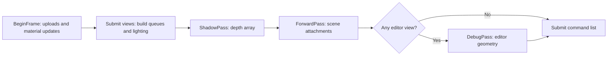

# Rendering pipeline

GraphicEngine currently renders scenes with a forward pipeline. `RenderSystem`
collects one or more viewport bindings per frame, prepares a `RenderView` for
each valid binding, builds draw queues, and submits those views to a render graph.
The graph contains shadow, forward, and (when an editor view exists) debug
passes. D3D11 is the shipped backend; Core records work through NVRHI.

## Frame and render graph

At `BeginFrame`, the render system opens its command list, applies queued GPU
uploads, updates dirty material constants, and resets the frame graph. View
submission resolves scene objects and cameras, builds per-view draw queues and
lighting data, and creates shadow views for shadow-casting lights. `EndFrame`
compiles and executes the graph, records GPU timing, closes and submits the
command list, and advances frame resources.

Each pass declares texture reads and writes during setup. The graph uses those
declarations to derive producer/consumer and read/write ordering, reject
transient reads without a producer and cycles, and sort active passes. Imported
viewport attachments keep their external texture handles; graph-created
textures are transient and borrowed from a per-frame pool for their declared
lifetimes. Before each pass, the graph applies the declared NVRHI resource
states and commits barriers. A pass failure stops execution and is reported by
the render system. `RenderGraph::Dump()` describes graph resources, pass order,
resource lifetimes, and access states for diagnostics.

### Pass responsibilities

- **`ShadowPass`** writes depth for shadow views into a transient 2D texture
  array. The configured shadow resolution is shared by its slices. The pass
  writes one slice per shadow view.
- **`ForwardPass`** reads the shadow map and renders each scene view to its
  imported color and depth attachments. It clears the attachments, draws the
  optional sky background into color only, then draws opaque, masked,
  transparent, and UI queues. The background runs before geometry with depth
  writes disabled, leaving depth and auxiliary outputs at their clear values.
- **`DebugPass`** writes the editor view attachments and draws editor debug
  geometry. It is added only when at least one submitted view uses editor mode;
  it skips preview and final views.

The graph is a scheduling and resource-state layer around these passes. It does
not currently provide a deferred/G-buffer renderer or general-purpose graph
editor. It includes camera-scoped screen-space ambient occlusion before the
forward lighting pass, followed by an ordered color-effect chain after forward
rendering and before display encoding. SSAO attenuates indirect diffuse lighting;
color grading, bloom, and FXAA operate in the ordered color stage.

## Shader and pipeline architecture

HLSL source is in `GraphicEngineBackends/D3D11/shaders`. The D3D11 CMake target
requires the Windows SDK `fxc` compiler and builds shader-model 5.0 vertex and
pixel shaders to DXBC files in the configured engine asset root's `shaders`
directory. Shared BRDF functions are in `brdf_common.hlsli`; CMake tracks HLSL
include files as shader build dependencies.

At runtime, Core's `ShaderFactory` resolves shader paths relative to
`GRAPHIC_ENGINE_ASSET_ROOT` (or the configured default asset root), loads DXBC,
and caches shader handles by normalized path. `MaterialSystem` creates the
standard material binding layout and material binding sets. `SceneRenderer`
combines shaders, vertex layout, material state, and framebuffer properties
into pipeline keys; `PipelineCache` reuses graphics pipelines for matching
keys. Material, scene, and per-object data use separate binding layouts.

The standard mesh shaders have an untextured pixel shader and a textured pixel
shader. Both use the selected material BRDF model and light data. The textured
variant additionally samples the material maps. Debug geometry uses dedicated
debug shaders, while alpha-masked shadow casters use a shadow pixel shader so
their base-color alpha cutoff is respected. Shader source or register-layout
changes must stay compatible with the CPU-side material and scene binding
layouts.

## Materials and PBR

`Engine::Renderer::MaterialProperties` is the editable CPU-side material
description. It supports metallic-roughness and specular-glossiness workflows,
dielectric reflectance from index of refraction or explicit F0, and eight BRDF
distributions: `GGX`, `GTR`, `Beckmann`, `Gauss`, `Blinn-Phong`,
`Ashikhmin-Shirley`, `Schlick`, and `Sawicki`. The default workflow is
metallic-roughness, the default model is `GGX`, and the default alpha mode is
opaque. Input
factors are sanitized and clamped when `BuildMaterialGpu` packs the shader
constant buffer. Beckmann and Gauss use the same perceptual-roughness-to-alpha
mapping as the other microfacet distributions. Gauss uses a normalized Gaussian
slope distribution with a finite zero at the horizon. Blinn-Phong uses the
normalized exponent distribution `D(NoH) = (n + 2) / (2π) * NoH^n`, with
`n = max(2 / alpha² - 2, 0)`. Its microfacet branch remains distinct from the
Legacy material data is rejected with a diagnostic that identifies the scene
entity or material and asks the author to reauthor it using a supported
distribution. It is never silently shaded as a different model.

Ashikhmin-Shirley uses separate perceptual roughness controls along the mesh
tangent and bitangent, both defaulting to `0.5` for isotropic behavior. The
material GPU ABI is version 6: anisotropic roughness occupies the reserved
`SpecularParams.w` and `AlphaParams.y` lanes. PRISM materials append 48 packed
coefficient lanes and normalization to the constant buffer, bringing
`MaterialGpu` to 512 bytes; their signed 64×64 residual is bound separately as
an R32F texture.
The normalized anisotropic cosine-power distribution uses the interpolated
tangent frame in both color pixel shaders and stays finite at the horizon for
broad roughness values.
Schlick uses a rational microfacet distribution with a supported half-vector domain and a finite result at minimum
material roughness.
Sawicki uses the normalized rational distribution
`D(NoH) = 96 * (3 + Nds) * NoH / (π * ((1 - Nds) * NoH + Nds + 3)^4)`,
where `Nds = 4 * alpha - 3` and alpha is the squared perceptual roughness
clamped to the material minimum. The implementation stays finite at grazing
angles and minimum roughness.

The textured shader supports base color, normal, metallic-roughness, occlusion,
and emissive maps, with a UV set and UV transform per slot. It applies the
corresponding factors and texture values during shading. The metallic-roughness
map follows the glTF channel convention: green supplies roughness and blue
supplies metallic. In the specular-glossiness workflow, glossiness is converted
to roughness and specular color drives dielectric reflectance. The normal map
supports a scale, and occlusion has a strength factor. Material constants are
packed in the CPU `MaterialGpu` structure and uploaded to the shader constant
buffer; keep that CPU/HLSL layout synchronized when changing either side.

Materials also select opaque, mask, or blend alpha behavior and whether
triangles are double-sided. Opaque and masked materials can cast shadows when
the entity's `CastShadows` option is enabled. Masked shadows use the material's
alpha cutoff; blended materials do not cast shadows. See [shadow caster
behavior](shadows.md) for the precise current rule.

## Multiple views, camera preview, and final output

Each `ViewportBinding` has its own scene, camera, target, dimensions, and render
mode. `Editor` mode renders editor debug geometry. `Preview` mode renders the
scene without editor overlays and can be used for a selected scene camera's
picture-in-picture view. `Final` mode renders to attachments for final output
and also omits editor overlays. Preview target dimensions determine that view's
aspect ratio; editor display scale and preview render quality are separate
preferences.

Final camera output uses an offscreen target at the requested dimensions. The
renderer captures final color, depth, world normal, specular-lighting, and
diffuse-lighting planes. Camera SSAO uses per-view depth and interpolated
world-space mesh normals
before forward shading; ambient diffuse is attenuated in `FinalColor` and
`DiffuseLighting`, while direct diffuse, emissive, specular lighting, depth, and
normals remain unchanged. The ordered color effects run on the GPU before
readback and affect only final color. `BeginFinalRender` submits GPU
copies to staging textures and returns a ticket; callers poll on the render
thread until the readback is ready. The optional CPU final-color hook runs after
readback; the other planes remain unprocessed. PNG export applies a display
transform, while selected-AOV multilayer EXR keeps float samples. See
[final rendering and output planes](final-render.md) and
[render output and image export](output.md) for their detailed contracts.

The final output path is a dedicated offscreen render workflow and allows only
one active final-render ticket at a time. The editor camera preview is a
separate interactive viewport and does not include editor debug geometry.
